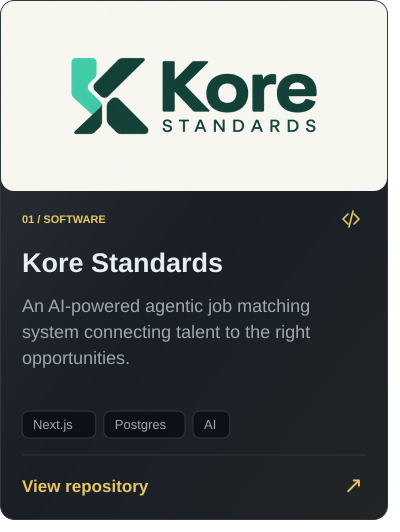

<h1 align="center">
    
</h1>

<!-- QUOTE:START -->

  <picture>
    <source media="(max-width: 600px) and (prefers-color-scheme: dark)" srcset="https://festo-contribution-journal.vercel.app/api/quote?format=svg&amp;theme=dark&amp;style=quiet&amp;v=166061&amp;layout=compact" />
    <source media="(max-width: 600px) and (prefers-color-scheme: light)" srcset="https://festo-contribution-journal.vercel.app/api/quote?format=svg&amp;theme=light&amp;style=quiet&amp;v=166061&amp;layout=compact" />
    <source media="(prefers-color-scheme: dark)" srcset="https://festo-contribution-journal.vercel.app/api/quote?format=svg&amp;theme=dark&amp;style=quiet&amp;v=166061" />
    <source media="(prefers-color-scheme: light)" srcset="https://festo-contribution-journal.vercel.app/api/quote?format=svg&amp;theme=light&amp;style=quiet&amp;v=166061" />
    
  </picture>
  
<a href="https://festo-contribution-journal.vercel.app/quotes/">Explore more inspiration ↗</a>

<!-- QUOTE:END -->

# Festo Wampamba
<!-- PROFILE-INTRO:START -->

<picture>
  <source media="(max-width: 600px) and (prefers-color-scheme: dark)" srcset="./assets/profile-intro-dark-compact.svg" />
  <source media="(max-width: 600px) and (prefers-color-scheme: light)" srcset="./assets/profile-intro-light-compact.svg" />
  <source media="(prefers-color-scheme: dark)" srcset="./assets/profile-intro-dark.svg" />
  <source media="(prefers-color-scheme: light)" srcset="./assets/profile-intro-light.svg" />
  
</picture>

<!-- PROFILE-INTRO:END -->

<!-- PROFILE-BADGES:START -->

<a href="https://www.youtube.com/channel/UCSiPOa3Vowwi42t1BysexmQ?sub_confirmation=1"><picture><source media="(prefers-color-scheme: dark)" srcset="./assets/badges/youtube-subscribers-dark.svg?v=1793469602331" /><source media="(prefers-color-scheme: light)" srcset="./assets/badges/youtube-subscribers-light.svg?v=1793469602331" /></picture></a> <a href="https://www.youtube.com/channel/UCSiPOa3Vowwi42t1BysexmQ"><picture><source media="(prefers-color-scheme: dark)" srcset="./assets/badges/youtube-views-dark.svg?v=1793469602331" /><source media="(prefers-color-scheme: light)" srcset="./assets/badges/youtube-views-light.svg?v=1793469602331" /></picture></a> <a href="https://github.com/Festo-Wampamba?tab=repositories"><picture><source media="(prefers-color-scheme: dark)" srcset="./assets/badges/github-repos-dark.svg?v=1793469602331" /><source media="(prefers-color-scheme: light)" srcset="./assets/badges/github-repos-light.svg?v=1793469602331" /></picture></a> <picture><source media="(prefers-color-scheme: dark)" srcset="./assets/badges/company-dark.svg?v=1793469602331" /><source media="(prefers-color-scheme: light)" srcset="./assets/badges/company-light.svg?v=1793469602331" /></picture>

<!-- PROFILE-BADGES:END -->

---

<!-- PROFILE-ABOUT:START -->
## 👨‍💻 About Me

<picture><source media="(max-width: 600px) and (prefers-color-scheme: dark)" srcset="./assets/about/education-dark-compact.svg" /><source media="(max-width: 600px) and (prefers-color-scheme: light)" srcset="./assets/about/education-light-compact.svg" /><source media="(prefers-color-scheme: dark)" srcset="./assets/about/education-dark.svg" /><source media="(prefers-color-scheme: light)" srcset="./assets/about/education-light.svg" /></picture> <a href="https://github.com/Festo-Wampamba/kore-standards"><picture><source media="(max-width: 600px) and (prefers-color-scheme: dark)" srcset="./assets/about/building-dark-compact.svg" /><source media="(max-width: 600px) and (prefers-color-scheme: light)" srcset="./assets/about/building-light-compact.svg" /><source media="(prefers-color-scheme: dark)" srcset="./assets/about/building-dark.svg" /><source media="(prefers-color-scheme: light)" srcset="./assets/about/building-light.svg" /></picture></a>

<a href="https://www.youtube.com/channel/UCSiPOa3Vowwi42t1BysexmQ"><picture><source media="(max-width: 600px) and (prefers-color-scheme: dark)" srcset="./assets/about/creating-dark-compact.svg" /><source media="(max-width: 600px) and (prefers-color-scheme: light)" srcset="./assets/about/creating-light-compact.svg" /><source media="(prefers-color-scheme: dark)" srcset="./assets/about/creating-dark.svg" /><source media="(prefers-color-scheme: light)" srcset="./assets/about/creating-light.svg" /></picture></a> <picture><source media="(max-width: 600px) and (prefers-color-scheme: dark)" srcset="./assets/about/expertise-dark-compact.svg" /><source media="(max-width: 600px) and (prefers-color-scheme: light)" srcset="./assets/about/expertise-light-compact.svg" /><source media="(prefers-color-scheme: dark)" srcset="./assets/about/expertise-dark.svg" /><source media="(prefers-color-scheme: light)" srcset="./assets/about/expertise-light.svg" /></picture>

<a href="mailto:festotechug@gmail.com"><picture><source media="(prefers-color-scheme: dark)" srcset="./assets/about/email-dark.svg" /><source media="(prefers-color-scheme: light)" srcset="./assets/about/email-light.svg" /></picture></a>

### 🤝 Connect with me

<a href="https://twitter.com/festo_techug"><picture><source media="(prefers-color-scheme: dark)" srcset="./assets/about/x-dark.svg" /><source media="(prefers-color-scheme: light)" srcset="./assets/about/x-light.svg" /></picture></a> <a href="https://www.linkedin.com/in/festoug/"><picture><source media="(prefers-color-scheme: dark)" srcset="./assets/about/linkedin-dark.svg" /><source media="(prefers-color-scheme: light)" srcset="./assets/about/linkedin-light.svg" /></picture></a> <a href="https://festoug.com"><picture><source media="(prefers-color-scheme: dark)" srcset="./assets/about/website-dark.svg" /><source media="(prefers-color-scheme: light)" srcset="./assets/about/website-light.svg" /></picture></a> <a href="https://www.youtube.com/channel/UCSiPOa3Vowwi42t1BysexmQ"><picture><source media="(prefers-color-scheme: dark)" srcset="./assets/about/youtube-dark.svg" /><source media="(prefers-color-scheme: light)" srcset="./assets/about/youtube-light.svg" /></picture></a>

<!-- PROFILE-ABOUT:END -->

---

<!-- PROFILE-SHOWCASE:START -->
## 📂 Project Showcase

<a href="https://github.com/Festo-Wampamba/kore-standards"><picture><source media="(max-width: 600px) and (prefers-color-scheme: dark)" srcset="./assets/showcase/kore-dark-compact.svg" /><source media="(max-width: 600px) and (prefers-color-scheme: light)" srcset="./assets/showcase/kore-light-compact.svg" /><source media="(prefers-color-scheme: dark)" srcset="./assets/showcase/kore-dark.svg" /><source media="(prefers-color-scheme: light)" srcset="./assets/showcase/kore-light.svg" /></picture></a> <a href="https://www.youtube.com/channel/UCSiPOa3Vowwi42t1BysexmQ"><picture><source media="(max-width: 600px) and (prefers-color-scheme: dark)" srcset="./assets/showcase/mastery-dark-compact.svg" /><source media="(max-width: 600px) and (prefers-color-scheme: light)" srcset="./assets/showcase/mastery-light-compact.svg" /><source media="(prefers-color-scheme: dark)" srcset="./assets/showcase/mastery-dark.svg" /><source media="(prefers-color-scheme: light)" srcset="./assets/showcase/mastery-light.svg" /></picture></a>

<!-- PROFILE-SHOWCASE:END -->

---

### 📺 Featured YouTube Videos

<!-- BEGIN YOUTUBE-CARDS -->

<a href="https://www.youtube.com/watch?v=cWG3g2gUlvg"><picture><source media="(max-width: 600px) and (prefers-color-scheme: dark)" srcset="./assets/videos/cWG3g2gUlvg-dark-compact.svg?v=1793477569412" /><source media="(max-width: 600px) and (prefers-color-scheme: light)" srcset="./assets/videos/cWG3g2gUlvg-light-compact.svg?v=1793477569412" /><source media="(prefers-color-scheme: dark)" srcset="./assets/videos/cWG3g2gUlvg-dark.svg?v=1793477569412" /><source media="(prefers-color-scheme: light)" srcset="./assets/videos/cWG3g2gUlvg-light.svg?v=1793477569412" /></picture></a> <a href="https://www.youtube.com/watch?v=9eBj_4fwLOg"><picture><source media="(max-width: 600px) and (prefers-color-scheme: dark)" srcset="./assets/videos/9eBj_4fwLOg-dark-compact.svg?v=1793477569412" /><source media="(max-width: 600px) and (prefers-color-scheme: light)" srcset="./assets/videos/9eBj_4fwLOg-light-compact.svg?v=1793477569412" /><source media="(prefers-color-scheme: dark)" srcset="./assets/videos/9eBj_4fwLOg-dark.svg?v=1793477569412" /><source media="(prefers-color-scheme: light)" srcset="./assets/videos/9eBj_4fwLOg-light.svg?v=1793477569412" /></picture></a>

<a href="https://www.youtube.com/watch?v=r95-iuuPgTY"><picture><source media="(max-width: 600px) and (prefers-color-scheme: dark)" srcset="./assets/videos/r95-iuuPgTY-dark-compact.svg?v=1793477569412" /><source media="(max-width: 600px) and (prefers-color-scheme: light)" srcset="./assets/videos/r95-iuuPgTY-light-compact.svg?v=1793477569412" /><source media="(prefers-color-scheme: dark)" srcset="./assets/videos/r95-iuuPgTY-dark.svg?v=1793477569412" /><source media="(prefers-color-scheme: light)" srcset="./assets/videos/r95-iuuPgTY-light.svg?v=1793477569412" /></picture></a> <a href="https://www.youtube.com/watch?v=3rWZCgPHOyI"><picture><source media="(max-width: 600px) and (prefers-color-scheme: dark)" srcset="./assets/videos/3rWZCgPHOyI-dark-compact.svg?v=1793477569412" /><source media="(max-width: 600px) and (prefers-color-scheme: light)" srcset="./assets/videos/3rWZCgPHOyI-light-compact.svg?v=1793477569412" /><source media="(prefers-color-scheme: dark)" srcset="./assets/videos/3rWZCgPHOyI-dark.svg?v=1793477569412" /><source media="(prefers-color-scheme: light)" srcset="./assets/videos/3rWZCgPHOyI-light.svg?v=1793477569412" /></picture></a>

<a href="https://www.youtube.com/watch?v=y0WUqvRaO-g"><picture><source media="(max-width: 600px) and (prefers-color-scheme: dark)" srcset="./assets/videos/y0WUqvRaO-g-dark-compact.svg?v=1793477569412" /><source media="(max-width: 600px) and (prefers-color-scheme: light)" srcset="./assets/videos/y0WUqvRaO-g-light-compact.svg?v=1793477569412" /><source media="(prefers-color-scheme: dark)" srcset="./assets/videos/y0WUqvRaO-g-dark.svg?v=1793477569412" /><source media="(prefers-color-scheme: light)" srcset="./assets/videos/y0WUqvRaO-g-light.svg?v=1793477569412" /></picture></a> <a href="https://www.youtube.com/watch?v=rrucKl2Df8c"><picture><source media="(max-width: 600px) and (prefers-color-scheme: dark)" srcset="./assets/videos/rrucKl2Df8c-dark-compact.svg?v=1793477569412" /><source media="(max-width: 600px) and (prefers-color-scheme: light)" srcset="./assets/videos/rrucKl2Df8c-light-compact.svg?v=1793477569412" /><source media="(prefers-color-scheme: dark)" srcset="./assets/videos/rrucKl2Df8c-dark.svg?v=1793477569412" /><source media="(prefers-color-scheme: light)" srcset="./assets/videos/rrucKl2Df8c-light.svg?v=1793477569412" /></picture></a>

Video views updated 31 Oct 2026 · Enterprise IT Mastery
<!-- END YOUTUBE-CARDS -->

<a href="https://www.youtube.com/channel/UCSiPOa3Vowwi42t1BysexmQ?sub_confirmation=1">Subscribe to Enterprise IT Mastery ↗</a>

---

## 💻 Tech Stacks

#### Languages
<a href="#"><picture><source media="(prefers-color-scheme: dark)" srcset="https://shieldcn.dev/badge/Python-FFD43B.svg?logo=python&variant=secondary&mode=dark"></picture></a> <a href="#"><picture><source media="(prefers-color-scheme: dark)" srcset="https://shieldcn.dev/badge/TypeScript-3178C6.svg?logo=typescript&variant=branded&mode=dark"></picture></a> <a href="#"><picture><source media="(prefers-color-scheme: dark)" srcset="https://shieldcn.dev/badge/JavaScript-F7DF1E.svg?logo=javascript&variant=branded&mode=dark"></picture></a> <a href="#"><picture><source media="(prefers-color-scheme: dark)" srcset="https://shieldcn.dev/badge/Shell%20Script-4EAA25.svg?logo=gnubash&variant=branded&mode=dark"></picture></a> <a href="#"><picture><source media="(prefers-color-scheme: dark)" srcset="https://shieldcn.dev/badge/PHP-777BB4.svg?logo=php&variant=branded&mode=dark"></picture></a> <a href="#"><picture><source media="(prefers-color-scheme: dark)" srcset="https://shieldcn.dev/badge/C%2B%2B-00599C.svg?logo=cplusplus&variant=branded&mode=dark"></picture></a>

#### Frameworks & Libraries
<a href="#"><picture><source media="(prefers-color-scheme: dark)" srcset="https://shieldcn.dev/badge/Next.js-000000.svg?logo=nextdotjs&variant=branded&mode=dark"></picture></a> <a href="#"><picture><source media="(prefers-color-scheme: dark)" srcset="https://shieldcn.dev/badge/React-61DAFB.svg?logo=react&variant=branded&mode=dark"></picture></a> <a href="#"><picture><source media="(prefers-color-scheme: dark)" srcset="https://shieldcn.dev/badge/TailwindCSS-06B6D4.svg?logo=tailwindcss&variant=branded&mode=dark"></picture></a> <a href="#"><picture><source media="(prefers-color-scheme: dark)" srcset="https://shieldcn.dev/badge/shadcn%2Fui-000000.svg?logo=shadcnui&variant=branded&mode=dark"></picture></a>

#### Backend & API's
<a href="#"><picture><source media="(prefers-color-scheme: dark)" srcset="https://shieldcn.dev/badge/Node.js-339933.svg?logo=nodedotjs&variant=branded&mode=dark"></picture></a> <a href="#"><picture><source media="(prefers-color-scheme: dark)" srcset="https://shieldcn.dev/badge/NestJS-E0234E.svg?logo=nestjs&variant=branded&mode=dark"></picture></a> <a href="#"><picture><source media="(prefers-color-scheme: dark)" srcset="https://shieldcn.dev/badge/FastAPI-009688.svg?logo=fastapi&variant=branded&mode=dark"></picture></a> <a href="#"><picture><source media="(prefers-color-scheme: dark)" srcset="https://shieldcn.dev/badge/REST%20API-6E56CF.svg?logo=false&variant=secondary&mode=dark"></picture></a> <a href="#"><picture><source media="(prefers-color-scheme: dark)" srcset="https://shieldcn.dev/badge/pnpm-F69220.svg?logo=pnpm&variant=branded&mode=dark"></picture></a> <a href="#"><picture><source media="(prefers-color-scheme: dark)" srcset="https://shieldcn.dev/badge/NPM-CB3837.svg?logo=npm&variant=branded&mode=dark"></picture></a>

#### Database & Storage
<a href="#"><picture><source media="(prefers-color-scheme: dark)" srcset="https://shieldcn.dev/badge/MySQL-4479A1.svg?logo=mysql&variant=branded&mode=dark"></picture></a> <a href="#"><picture><source media="(prefers-color-scheme: dark)" srcset="https://shieldcn.dev/badge/PostgreSQL-4169E1.svg?logo=postgresql&variant=branded&mode=dark"></picture></a> <a href="#"><picture><source media="(prefers-color-scheme: dark)" srcset="https://shieldcn.dev/badge/Neon-00E599.svg?logo=neon&variant=branded&mode=dark"></picture></a> <a href="#"><picture><source media="(prefers-color-scheme: dark)" srcset="https://shieldcn.dev/badge/MariaDB-003545.svg?logo=mariadb&variant=branded&mode=dark"></picture></a> <a href="#"><picture><source media="(prefers-color-scheme: dark)" srcset="https://shieldcn.dev/badge/Drizzle-C5F74F.svg?logo=drizzle&variant=branded&mode=dark"></picture></a>

#### Hosting & Servers
<a href="#"><picture><source media="(prefers-color-scheme: dark)" srcset="https://shieldcn.dev/badge/Vercel-000000.svg?logo=vercel&variant=branded&mode=dark"></picture></a> <a href="#"><picture><source media="(prefers-color-scheme: dark)" srcset="https://shieldcn.dev/badge/Hostinger-673DE6.svg?logo=hostinger&variant=branded&mode=dark"></picture></a> <a href="#"><picture><source media="(prefers-color-scheme: dark)" srcset="https://shieldcn.dev/badge/Contabo-1B2A4A.svg?logo=false&variant=secondary&mode=dark"></picture></a> <a href="#"><picture><source media="(prefers-color-scheme: dark)" srcset="https://shieldcn.dev/badge/Azure-0078D4.svg?logo=microsoftazure&variant=branded&mode=dark"></picture></a> <a href="#"><picture><source media="(prefers-color-scheme: dark)" srcset="https://shieldcn.dev/badge/Dokploy-000000.svg?logo=false&variant=secondary&mode=dark"></picture></a> <a href="#"><picture><source media="(prefers-color-scheme: dark)" srcset="https://shieldcn.dev/badge/Apache-D22128.svg?logo=apache&variant=branded&mode=dark"></picture></a> <a href="#"><picture><source media="(prefers-color-scheme: dark)" srcset="https://shieldcn.dev/badge/Nginx-009639.svg?logo=nginx&variant=branded&mode=dark"></picture></a>

#### OS & Tools
<a href="#"><picture><source media="(prefers-color-scheme: dark)" srcset="https://shieldcn.dev/badge/Linux-FCC624.svg?logo=linux&variant=branded&mode=dark"></picture></a> <a href="#"><picture><source media="(prefers-color-scheme: dark)" srcset="https://shieldcn.dev/badge/Windows-0078D6.svg?logo=windows&variant=branded&mode=dark"></picture></a> <a href="#"><picture><source media="(prefers-color-scheme: dark)" srcset="https://shieldcn.dev/badge/Ubuntu-E95420.svg?logo=ubuntu&variant=branded&mode=dark"></picture></a> <a href="#"><picture><source media="(prefers-color-scheme: dark)" srcset="https://shieldcn.dev/badge/Docker-2496ED.svg?logo=docker&variant=branded&mode=dark"></picture></a> <a href="#"><picture><source media="(prefers-color-scheme: dark)" srcset="https://shieldcn.dev/badge/Git-F05032.svg?logo=git&variant=branded&mode=dark"></picture></a> <a href="#"><picture><source media="(prefers-color-scheme: dark)" srcset="https://shieldcn.dev/badge/GitHub-181717.svg?logo=github&variant=branded&mode=dark"></picture></a>

### 📦 Top Repositories

<a href="https://github.com/Festo-Wampamba/kore-standards"><picture><source media="(prefers-color-scheme: dark)" srcset="https://www.shieldcn.dev/github/stars/Festo-Wampamba/kore-standards.svg?variant=secondary&amp;mode=dark"></picture></a>

---

<h3 align="left">Support:</h3>

# 📊 GitHub Stats

  <picture>
    <source media="(prefers-color-scheme: dark)" srcset="./assets/profile-stats-dark.svg" />
    <source media="(prefers-color-scheme: light)" srcset="./assets/profile-stats-light.svg" />
    
  </picture>
  
<a href="https://festo-contribution-journal.vercel.app/stats/">Explore the GitHub overview ↗</a>

---

## 📈 Contribution Graph

  <picture>
    <source media="(prefers-color-scheme: dark)" srcset="./assets/contribution-graph-dark.svg" />
    <source media="(prefers-color-scheme: light)" srcset="./assets/contribution-graph-light.svg" />
    
  </picture>
  
<a href="https://festo-contribution-journal.vercel.app">Explore the interactive contribution journal ↗</a>

---

### ✍️  Festo's Random Quotes

  

---

###

 

<a href="https://festo-contribution-journal.vercel.app/pacman/">
  <picture>
    <source media="(prefers-color-scheme: dark)" srcset="https://festo-contribution-journal.vercel.app/pacman/pacman-dark.svg">
    <source media="(prefers-color-scheme: light)" srcset="https://festo-contribution-journal.vercel.app/pacman/pacman-light.svg">
    
  </picture>
</a>

<a href="https://festo-contribution-journal.vercel.app/pacman/">Explore the Pac-Man replay · pause, restart and change theme ↗</a>

###

 ### Show some love by starring some repositories

  ## 💰 Support me by sponsoring my projects
   
 
