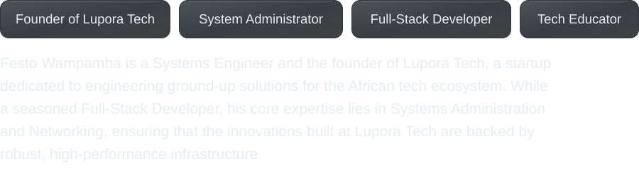
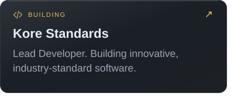
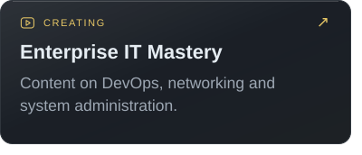
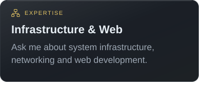

<h1 align="center">
    
</h1>

<!-- QUOTE:START -->

  <picture>
    <source media="(max-width: 600px) and (prefers-color-scheme: dark)" srcset="https://festo-contribution-journal.vercel.app/api/quote?format=svg&amp;theme=dark&amp;style=quiet&amp;v=166095&amp;layout=compact" />
    <source media="(max-width: 600px) and (prefers-color-scheme: light)" srcset="https://festo-contribution-journal.vercel.app/api/quote?format=svg&amp;theme=light&amp;style=quiet&amp;v=166095&amp;layout=compact" />
    <source media="(prefers-color-scheme: dark)" srcset="https://festo-contribution-journal.vercel.app/api/quote?format=svg&amp;theme=dark&amp;style=quiet&amp;v=166095" />
    <source media="(prefers-color-scheme: light)" srcset="https://festo-contribution-journal.vercel.app/api/quote?format=svg&amp;theme=light&amp;style=quiet&amp;v=166095" />
    
  </picture>
  
<a href="https://festo-contribution-journal.vercel.app/quotes/">Explore more inspiration ↗</a>

<!-- QUOTE:END -->

# Festo Wampamba
<!-- PROFILE-INTRO:START -->

<picture>
  <source media="(max-width: 600px) and (prefers-color-scheme: dark)" srcset="./assets/profile-intro-dark-compact.svg" />
  <source media="(max-width: 600px) and (prefers-color-scheme: light)" srcset="./assets/profile-intro-light-compact.svg" />
  <source media="(prefers-color-scheme: dark)" srcset="./assets/profile-intro-dark.svg" />
  <source media="(prefers-color-scheme: light)" srcset="./assets/profile-intro-light.svg" />
  
</picture>

<!-- PROFILE-INTRO:END -->

<!-- PROFILE-BADGES:START -->

<a href="https://www.youtube.com/channel/UCSiPOa3Vowwi42t1BysexmQ?sub_confirmation=1"><picture><source media="(prefers-color-scheme: dark)" srcset="./assets/badges/youtube-subscribers-dark.svg?v=1793760225951" /><source media="(prefers-color-scheme: light)" srcset="./assets/badges/youtube-subscribers-light.svg?v=1793760225951" /></picture></a> <a href="https://www.youtube.com/channel/UCSiPOa3Vowwi42t1BysexmQ"><picture><source media="(prefers-color-scheme: dark)" srcset="./assets/badges/youtube-views-dark.svg?v=1793760225951" /><source media="(prefers-color-scheme: light)" srcset="./assets/badges/youtube-views-light.svg?v=1793760225951" /></picture></a> <a href="https://github.com/Festo-Wampamba?tab=repositories"><picture><source media="(prefers-color-scheme: dark)" srcset="./assets/badges/github-repos-dark.svg?v=1793760225951" /><source media="(prefers-color-scheme: light)" srcset="./assets/badges/github-repos-light.svg?v=1793760225951" /></picture></a> <picture><source media="(prefers-color-scheme: dark)" srcset="./assets/badges/company-dark.svg?v=1793760225951" /><source media="(prefers-color-scheme: light)" srcset="./assets/badges/company-light.svg?v=1793760225951" /></picture>

<!-- PROFILE-BADGES:END -->

---

<!-- PROFILE-ABOUT:START -->
## 👨‍💻 About Me

<picture><source media="(max-width: 600px) and (prefers-color-scheme: dark)" srcset="./assets/about/education-dark-compact.svg" /><source media="(max-width: 600px) and (prefers-color-scheme: light)" srcset="./assets/about/education-light-compact.svg" /><source media="(prefers-color-scheme: dark)" srcset="./assets/about/education-dark.svg" /><source media="(prefers-color-scheme: light)" srcset="./assets/about/education-light.svg" /></picture> <a href="https://github.com/Festo-Wampamba/kore-standards"><picture><source media="(max-width: 600px) and (prefers-color-scheme: dark)" srcset="./assets/about/building-dark-compact.svg" /><source media="(max-width: 600px) and (prefers-color-scheme: light)" srcset="./assets/about/building-light-compact.svg" /><source media="(prefers-color-scheme: dark)" srcset="./assets/about/building-dark.svg" /><source media="(prefers-color-scheme: light)" srcset="./assets/about/building-light.svg" /></picture></a>

<a href="https://www.youtube.com/channel/UCSiPOa3Vowwi42t1BysexmQ"><picture><source media="(max-width: 600px) and (prefers-color-scheme: dark)" srcset="./assets/about/creating-dark-compact.svg" /><source media="(max-width: 600px) and (prefers-color-scheme: light)" srcset="./assets/about/creating-light-compact.svg" /><source media="(prefers-color-scheme: dark)" srcset="./assets/about/creating-dark.svg" /><source media="(prefers-color-scheme: light)" srcset="./assets/about/creating-light.svg" /></picture></a> <picture><source media="(max-width: 600px) and (prefers-color-scheme: dark)" srcset="./assets/about/expertise-dark-compact.svg" /><source media="(max-width: 600px) and (prefers-color-scheme: light)" srcset="./assets/about/expertise-light-compact.svg" /><source media="(prefers-color-scheme: dark)" srcset="./assets/about/expertise-dark.svg" /><source media="(prefers-color-scheme: light)" srcset="./assets/about/expertise-light.svg" /></picture>

<a href="mailto:festotechug@gmail.com"><picture><source media="(prefers-color-scheme: dark)" srcset="./assets/about/email-dark.svg" /><source media="(prefers-color-scheme: light)" srcset="./assets/about/email-light.svg" /></picture></a>

### 🤝 Connect with me

<a href="https://twitter.com/festo_techug"><picture><source media="(prefers-color-scheme: dark)" srcset="./assets/about/x-dark.svg" /><source media="(prefers-color-scheme: light)" srcset="./assets/about/x-light.svg" /></picture></a> <a href="https://www.linkedin.com/in/festoug/"><picture><source media="(prefers-color-scheme: dark)" srcset="./assets/about/linkedin-dark.svg" /><source media="(prefers-color-scheme: light)" srcset="./assets/about/linkedin-light.svg" /></picture></a> <a href="https://festoug.com"><picture><source media="(prefers-color-scheme: dark)" srcset="./assets/about/website-dark.svg" /><source media="(prefers-color-scheme: light)" srcset="./assets/about/website-light.svg" /></picture></a> <a href="https://www.youtube.com/channel/UCSiPOa3Vowwi42t1BysexmQ"><picture><source media="(prefers-color-scheme: dark)" srcset="./assets/about/youtube-dark.svg" /><source media="(prefers-color-scheme: light)" srcset="./assets/about/youtube-light.svg" /></picture></a>

<!-- PROFILE-ABOUT:END -->

---

<!-- PROFILE-SHOWCASE:START -->
## 📂 Project Showcase

<a href="https://github.com/Festo-Wampamba/kore-standards"><picture><source media="(max-width: 600px) and (prefers-color-scheme: dark)" srcset="./assets/showcase/kore-dark-compact.svg?v=kore-logo-v1" /><source media="(max-width: 600px) and (prefers-color-scheme: light)" srcset="./assets/showcase/kore-light-compact.svg?v=kore-logo-v1" /><source media="(prefers-color-scheme: dark)" srcset="./assets/showcase/kore-dark.svg?v=kore-logo-v1" /><source media="(prefers-color-scheme: light)" srcset="./assets/showcase/kore-light.svg?v=kore-logo-v1" /></picture></a> <a href="https://www.youtube.com/channel/UCSiPOa3Vowwi42t1BysexmQ?sub_confirmation=1"><picture><source media="(max-width: 600px) and (prefers-color-scheme: dark)" srcset="./assets/showcase/mastery-dark-compact.svg?v=eim-logo-v4" /><source media="(max-width: 600px) and (prefers-color-scheme: light)" srcset="./assets/showcase/mastery-light-compact.svg?v=eim-logo-v4" /><source media="(prefers-color-scheme: dark)" srcset="./assets/showcase/mastery-dark.svg?v=eim-logo-v4" /><source media="(prefers-color-scheme: light)" srcset="./assets/showcase/mastery-light.svg?v=eim-logo-v4" /></picture></a>

<!-- PROFILE-SHOWCASE:END -->

---

### 📺 Featured YouTube Videos

<!-- BEGIN YOUTUBE-CARDS -->

<a href="https://www.youtube.com/watch?v=cWG3g2gUlvg"><picture><source media="(max-width: 600px) and (prefers-color-scheme: dark)" srcset="./assets/videos/cWG3g2gUlvg-dark-compact.svg?v=1793770186336-three-column" /><source media="(max-width: 600px) and (prefers-color-scheme: light)" srcset="./assets/videos/cWG3g2gUlvg-light-compact.svg?v=1793770186336-three-column" /><source media="(prefers-color-scheme: dark)" srcset="./assets/videos/cWG3g2gUlvg-dark.svg?v=1793770186336-three-column" /><source media="(prefers-color-scheme: light)" srcset="./assets/videos/cWG3g2gUlvg-light.svg?v=1793770186336-three-column" /></picture></a> <a href="https://www.youtube.com/watch?v=9eBj_4fwLOg"><picture><source media="(max-width: 600px) and (prefers-color-scheme: dark)" srcset="./assets/videos/9eBj_4fwLOg-dark-compact.svg?v=1793770186336-three-column" /><source media="(max-width: 600px) and (prefers-color-scheme: light)" srcset="./assets/videos/9eBj_4fwLOg-light-compact.svg?v=1793770186336-three-column" /><source media="(prefers-color-scheme: dark)" srcset="./assets/videos/9eBj_4fwLOg-dark.svg?v=1793770186336-three-column" /><source media="(prefers-color-scheme: light)" srcset="./assets/videos/9eBj_4fwLOg-light.svg?v=1793770186336-three-column" /></picture></a> <a href="https://www.youtube.com/watch?v=r95-iuuPgTY"><picture><source media="(max-width: 600px) and (prefers-color-scheme: dark)" srcset="./assets/videos/r95-iuuPgTY-dark-compact.svg?v=1793770186336-three-column" /><source media="(max-width: 600px) and (prefers-color-scheme: light)" srcset="./assets/videos/r95-iuuPgTY-light-compact.svg?v=1793770186336-three-column" /><source media="(prefers-color-scheme: dark)" srcset="./assets/videos/r95-iuuPgTY-dark.svg?v=1793770186336-three-column" /><source media="(prefers-color-scheme: light)" srcset="./assets/videos/r95-iuuPgTY-light.svg?v=1793770186336-three-column" /></picture></a>

<a href="https://www.youtube.com/watch?v=3rWZCgPHOyI"><picture><source media="(max-width: 600px) and (prefers-color-scheme: dark)" srcset="./assets/videos/3rWZCgPHOyI-dark-compact.svg?v=1793770186336-three-column" /><source media="(max-width: 600px) and (prefers-color-scheme: light)" srcset="./assets/videos/3rWZCgPHOyI-light-compact.svg?v=1793770186336-three-column" /><source media="(prefers-color-scheme: dark)" srcset="./assets/videos/3rWZCgPHOyI-dark.svg?v=1793770186336-three-column" /><source media="(prefers-color-scheme: light)" srcset="./assets/videos/3rWZCgPHOyI-light.svg?v=1793770186336-three-column" /></picture></a> <a href="https://www.youtube.com/watch?v=y0WUqvRaO-g"><picture><source media="(max-width: 600px) and (prefers-color-scheme: dark)" srcset="./assets/videos/y0WUqvRaO-g-dark-compact.svg?v=1793770186336-three-column" /><source media="(max-width: 600px) and (prefers-color-scheme: light)" srcset="./assets/videos/y0WUqvRaO-g-light-compact.svg?v=1793770186336-three-column" /><source media="(prefers-color-scheme: dark)" srcset="./assets/videos/y0WUqvRaO-g-dark.svg?v=1793770186336-three-column" /><source media="(prefers-color-scheme: light)" srcset="./assets/videos/y0WUqvRaO-g-light.svg?v=1793770186336-three-column" /></picture></a> <a href="https://www.youtube.com/watch?v=rrucKl2Df8c"><picture><source media="(max-width: 600px) and (prefers-color-scheme: dark)" srcset="./assets/videos/rrucKl2Df8c-dark-compact.svg?v=1793770186336-three-column" /><source media="(max-width: 600px) and (prefers-color-scheme: light)" srcset="./assets/videos/rrucKl2Df8c-light-compact.svg?v=1793770186336-three-column" /><source media="(prefers-color-scheme: dark)" srcset="./assets/videos/rrucKl2Df8c-dark.svg?v=1793770186336-three-column" /><source media="(prefers-color-scheme: light)" srcset="./assets/videos/rrucKl2Df8c-light.svg?v=1793770186336-three-column" /></picture></a>

Video views updated 4 Nov 2026 · Enterprise IT Mastery
<!-- END YOUTUBE-CARDS -->

<a href="https://www.youtube.com/channel/UCSiPOa3Vowwi42t1BysexmQ?sub_confirmation=1">Subscribe to Enterprise IT Mastery ↗</a>

---

<!-- PROFILE-TECH:START -->
## 💻 Tech Stacks

#### Languages

    

#### Frameworks & Libraries

   

#### Backend & API's

    

#### Database & Storage

   

#### Hosting & Servers

      

#### OS & Tools

     

<!-- PROFILE-TECH:END -->

### 📦 Top Repositories

<a href="https://github.com/Festo-Wampamba/kore-standards"><picture><source media="(prefers-color-scheme: dark)" srcset="https://www.shieldcn.dev/github/stars/Festo-Wampamba/kore-standards.svg?variant=secondary&amp;mode=dark"></picture></a>

---

<!-- PROFILE-COFFEE:START -->
### ☕ Support my work

<a href="https://www.buymeacoffee.com/festoug"><picture><source media="(max-width: 600px) and (prefers-color-scheme: dark)" srcset="./assets/support/coffee-dark-compact.svg?v=glass-v1" /><source media="(max-width: 600px) and (prefers-color-scheme: light)" srcset="./assets/support/coffee-light-compact.svg?v=glass-v1" /><source media="(prefers-color-scheme: dark)" srcset="./assets/support/coffee-dark.svg?v=glass-v1" /><source media="(prefers-color-scheme: light)" srcset="./assets/support/coffee-light.svg?v=glass-v1" /></picture></a>

<!-- PROFILE-COFFEE:END -->

# 📊 GitHub Stats

  <picture>
    <source media="(prefers-color-scheme: dark)" srcset="./assets/profile-stats-dark.svg" />
    <source media="(prefers-color-scheme: light)" srcset="./assets/profile-stats-light.svg" />
    
  </picture>
  
<a href="https://festo-contribution-journal.vercel.app/stats/">Explore the GitHub overview ↗</a>

---

## 📈 Contribution Graph

  <picture>
    <source media="(prefers-color-scheme: dark)" srcset="./assets/contribution-graph-dark.svg" />
    <source media="(prefers-color-scheme: light)" srcset="./assets/contribution-graph-light.svg" />
    
  </picture>
  
<a href="https://festo-contribution-journal.vercel.app">Explore the interactive contribution journal ↗</a>

---

### ✍️ Festo's Random Quotes

  <picture>
    <source media="(max-width: 600px) and (prefers-color-scheme: dark)" srcset="https://quotes-github-readme.vercel.app/api?type=vertical&amp;theme=dark&amp;quoteColor=e6edf3&amp;authorColor=e5c565&amp;backgroundColor=161b22&amp;symbolColor=30363d&amp;border=true" />
    <source media="(max-width: 600px) and (prefers-color-scheme: light)" srcset="https://quotes-github-readme.vercel.app/api?type=vertical&amp;theme=light&amp;quoteColor=252821&amp;authorColor=8a5e00&amp;backgroundColor=fffefa&amp;symbolColor=deded4&amp;border=true" />
    <source media="(prefers-color-scheme: dark)" srcset="https://quotes-github-readme.vercel.app/api?type=horizontal&amp;theme=dark&amp;quoteColor=e6edf3&amp;authorColor=e5c565&amp;backgroundColor=161b22&amp;symbolColor=30363d&amp;border=true" />
    <source media="(prefers-color-scheme: light)" srcset="https://quotes-github-readme.vercel.app/api?type=horizontal&amp;theme=light&amp;quoteColor=252821&amp;authorColor=8a5e00&amp;backgroundColor=fffefa&amp;symbolColor=deded4&amp;border=true" />
    
  </picture>

---

###

 

<a href="https://festo-contribution-journal.vercel.app/pacman/">
  <picture>
    <source media="(prefers-color-scheme: dark)" srcset="https://festo-contribution-journal.vercel.app/pacman/pacman-dark.svg">
    <source media="(prefers-color-scheme: light)" srcset="https://festo-contribution-journal.vercel.app/pacman/pacman-light.svg">
    
  </picture>
</a>

<a href="https://festo-contribution-journal.vercel.app/pacman/">Explore the Pac-Man replay · pause, restart and change theme ↗</a>

<!-- PROFILE-SUPPORT:START -->

<a href="https://github.com/Festo-Wampamba?tab=repositories"><picture><source media="(max-width: 600px) and (prefers-color-scheme: dark)" srcset="./assets/support/star-dark-compact.svg?v=glass-v1" /><source media="(max-width: 600px) and (prefers-color-scheme: light)" srcset="./assets/support/star-light-compact.svg?v=glass-v1" /><source media="(prefers-color-scheme: dark)" srcset="./assets/support/star-dark.svg?v=glass-v1" /><source media="(prefers-color-scheme: light)" srcset="./assets/support/star-light.svg?v=glass-v1" /></picture></a>

## 💰 Support me by sponsoring my projects

<a href="https://paypal.me/festo12"><picture><source media="(max-width: 600px) and (prefers-color-scheme: dark)" srcset="./assets/support/paypal-dark-compact.svg?v=glass-v1" /><source media="(max-width: 600px) and (prefers-color-scheme: light)" srcset="./assets/support/paypal-light-compact.svg?v=glass-v1" /><source media="(prefers-color-scheme: dark)" srcset="./assets/support/paypal-dark.svg?v=glass-v1" /><source media="(prefers-color-scheme: light)" srcset="./assets/support/paypal-light.svg?v=glass-v1" /></picture></a> <a href="https://ko-fi.com/festo"><picture><source media="(max-width: 600px) and (prefers-color-scheme: dark)" srcset="./assets/support/kofi-dark-compact.svg?v=glass-v1" /><source media="(max-width: 600px) and (prefers-color-scheme: light)" srcset="./assets/support/kofi-light-compact.svg?v=glass-v1" /><source media="(prefers-color-scheme: dark)" srcset="./assets/support/kofi-dark.svg?v=glass-v1" /><source media="(prefers-color-scheme: light)" srcset="./assets/support/kofi-light.svg?v=glass-v1" /></picture></a> <a href="https://patreon.com/SoftwareEngineer960"><picture><source media="(max-width: 600px) and (prefers-color-scheme: dark)" srcset="./assets/support/patreon-dark-compact.svg?v=glass-v1" /><source media="(max-width: 600px) and (prefers-color-scheme: light)" srcset="./assets/support/patreon-light-compact.svg?v=glass-v1" /><source media="(prefers-color-scheme: dark)" srcset="./assets/support/patreon-dark.svg?v=glass-v1" /><source media="(prefers-color-scheme: light)" srcset="./assets/support/patreon-light.svg?v=glass-v1" /></picture></a>

<!-- PROFILE-SUPPORT:END -->
